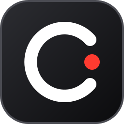
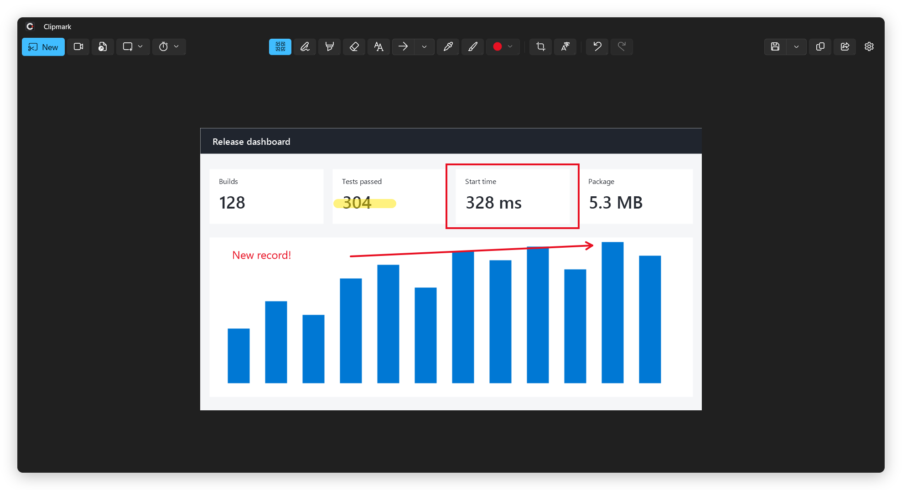
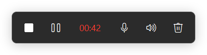

<p align="center">
  
</p>

<h1 align="center">Clipmark</h1>

<p align="center">
  Screen capture, annotation and screen recording for Windows 11.<br>
  The Snipping Tool workflow with a real annotation editor, in a small Native AOT app.
</p>



## Features

Items marked **(Premium)** need a license key after the 30-day trial. See [Free and Premium](#free-and-premium).

**Capture**
- Rectangle, window, full screen (the monitor you click), all monitors and freeform, on every monitor, including
  monitors left of or above the primary one
- Delay of 3, 5 or 10 seconds; global hotkey (Ctrl+Print Screen by default, or Print Screen itself)
- Optional copy to clipboard, automatic save and notification after each capture
- Text extractor: pick a region and its text goes straight to the clipboard

**Editor**
- Pen, highlighter, object eraser, rectangle, oval, line and arrow (Shift snaps to 45 degrees)
- Select, move, resize and rotate any object at any time; arrows attach to shapes and follow them **(Premium)**
- Text labels, eyedropper (copies `#RRGGBB`), fill for shapes and the background **(Premium)**
- Crop with handles or exact X / Y / W / H fields that accept arithmetic (`800+20`)
- Color ring, width presets, mouse wheel sets width or text size; undo / redo
- Save as PNG or JPEG, copy, share
- "Save as editable PNG" keeps every object editable when you reopen the file **(Premium)**. Any copy of Clipmark opens
  editable PNGs.

**Text actions**
- OCR copy (Windows text recognition), quick redact of email addresses and phone numbers, QR code decoding

**Send to AI (Premium)**
- Pastes the capture into a running Claude Code or Codex CLI session, the Claude or ChatGPT desktop app, or the Claude
  or Codex extension in VS Code
- In Windows Terminal, Clipmark names the agent's tab and asks you to switch to it instead of typing into another tab

**Capture history (Premium, off by default)**
- Keeps your last 25 captures with their annotations in `%LOCALAPPDATA%\Clipmark\History`, encrypted for your Windows
  account (DPAPI)
- Edits you make to a history item are written back to it

**Screen recording**
- Record a region, a window area or a full screen to MP4 (H.264 + AAC, 30 fps)
- System audio and microphone, mixed into one track
- Record bar with a 3 second countdown, kept out of the video



**System**
- Lives in the tray (shown on the taskbar the first time it runs), single instance, starts with Windows on request
- Toast notifications with banners; clicking one opens the capture while Clipmark runs

## Clipmark vs Snipping Tool

The Snipping Tool column was tested on Snipping Tool 11.2608.41.0 (Windows 11 build 26300) in October 2026 and checked
against Microsoft's [Snipping Tool help page](https://support.microsoft.com/en-us/windows/apps/use-snipping-tool-to-capture-screenshots).

| | Clipmark | Snipping Tool |
|---|---|---|
| Capture modes | Rectangle, window, full screen (one monitor), all monitors, freeform | Rectangle, window, full screen (all monitors as one image), freeform |
| Pen, highlighter, eraser | Yes | Yes |
| Shapes | Rectangle, oval, line, arrow | Rectangle, oval, line, arrow, emoji |
| Shape fill | Yes, also fills the background (Premium) | Yes, fill and outline color |
| Move, resize, rotate shapes | Any object, any time (Premium) | Only the shape you just drew |
| Arrows that attach to shapes and follow them | Yes (Premium) | No |
| Text labels | Yes, editable later (Premium) | No text tool (Edit in Paint) |
| Color picker | Eyedropper in the editor (Premium) | In the capture toolbar |
| Reopen a capture with editable objects | Yes, editable PNG (Premium to save) | No |
| OCR copy and quick redact | Yes | Yes |
| Copy recognized text as a table | No | Yes |
| QR code decoding | Yes | Not seen in the tested version |
| Screen recording | Region, window area or full screen; MP4 with system audio and microphone | Rectangle or window; MP4 with system audio and microphone, edit in Clipchamp |
| Send the capture to an AI agent | Yes (Premium) | No |
| Perfect screenshot (automatic fit to content) | No | Copilot+ PCs only |

**Footprint** (measured on the development PC, median of 5 starts)

| | Clipmark 1.0.0 (self-contained zip) | Snipping Tool 11.2608 |
|---|---|---|
| Size on disk | 72 MB | 586 MB |
| Window visible after start | 328 ms | 359 ms |
| Idle private memory | 92 MB | 83 MB |

## Free and Premium

The source code is MIT licensed. Clipmark 1.0.0 has no license check: every feature is free.

From the next release on, a new install starts a 30-day Premium trial. After the trial, these features need a license
key: select / move / resize / rotate, attached arrows, text labels, fill, eyedropper, saving editable PNGs, Send to AI
and the capture history. Everything else, including capture, recording, OCR, crop and saving PNG or JPEG, stays free.
You enter the key in Settings. The key works offline and contains no name and no email address.

## Install

1. Download `Clipmark-<version>-win-x64.zip` from [Releases](https://github.com/IT-BAER/clipmark/releases).
2. Extract it to a folder of your choice, for example `%LOCALAPPDATA%\Programs\Clipmark`.
3. Run `Clipmark.App.exe`. It adds a "Clipmark" Start menu entry (needed for notification banners) and sits in the tray.

Requirements: Windows 11 x64 (build 22000 or later). No runtime installation is needed.

The build is not code-signed yet, so SmartScreen may warn on first start ("More info" > "Run anyway").

**Remove**
1. Run `Clipmark.App.exe --restore-system` once, or turn off "Use the Print Screen key" and "Start Clipmark when
   Windows starts" in Settings. This puts the Windows Print Screen option back and removes the autostart entry; the
   command line option also removes the Start menu shortcut.
2. Delete the program folder and `%LOCALAPPDATA%\Clipmark` (settings, license key, capture history).
3. Optional: delete the trial record in `HKCU\Software\Clipmark` and in Windows Credential Manager ("Windows
   Credentials", entry `Clipmark/Trial`). Clipmark keeps it so that a reinstall does not restart the trial.

Your screenshots and recordings stay where you saved them.

## Usage

| Action | Default |
|---|---|
| New capture | Ctrl+Print Screen, tray icon click, or New |
| New recording | Ctrl+Shift+Print Screen, tray menu, or the camera button; the same hotkey or a tray icon click stops it |
| Tools | V select, P pen, H highlighter, E eraser, R / C / L / A shapes, T text, I eyedropper, G fill |
| Editing | Ctrl+Z / Ctrl+Y, Ctrl+C copy, Ctrl+S save, Ctrl+Shift+S save editable, Ctrl+O open, Ctrl+N new |
| Selection | Ctrl+A select all, arrow keys nudge (Shift = 10 px), Page Up / Down z-order (Shift = to front / back), Del delete, Esc deselect |

Recordings are saved to `Videos\Screen Recordings`. Screenshots go to `Pictures\Screenshots` (configurable) when
automatic save is on.

## Build from source

- .NET SDK 10, Windows SDK 10.0.26100
- For Native AOT publishing: Visual Studio Build Tools with the C++ workload (MSVC linker)

```powershell
dotnet test tests/Clipmark.Core.Tests
dotnet build src/Clipmark.App -p:Platform=x64 -p:WindowsPackageType=None
pwsh scripts/publish-release.ps1   # self-contained Native AOT zip in artifacts\release
```

`src/Clipmark.Core` holds the document model, geometry, editable file format, audio mixer, licensing, history store
and settings, fully unit tested. `src/Clipmark.App` is the WinUI 3 app (Win2D canvas, GDI overlay,
Windows.Graphics.Capture recorder, WASAPI).

## Privacy

Clipmark makes no network connections and has no telemetry. Send to AI pastes into an app you already run, and that
app decides what it uploads. See the [privacy policy](docs/privacy-policy.md).

## Disclaimer

Clipmark is an independent project and is not affiliated with Microsoft. See
[THIRD-PARTY-NOTICES.md](THIRD-PARTY-NOTICES.md) for the libraries it uses.

## License

[MIT](LICENSE)
