> **Before you start:** Install Clipmark from the Microsoft Store and start it once. Clipmark then runs in the background, with its icon in the notification area of the taskbar.

## 1. Start a capture

Press `Ctrl`+`Print Screen`. You can also click **New** in the Clipmark window.

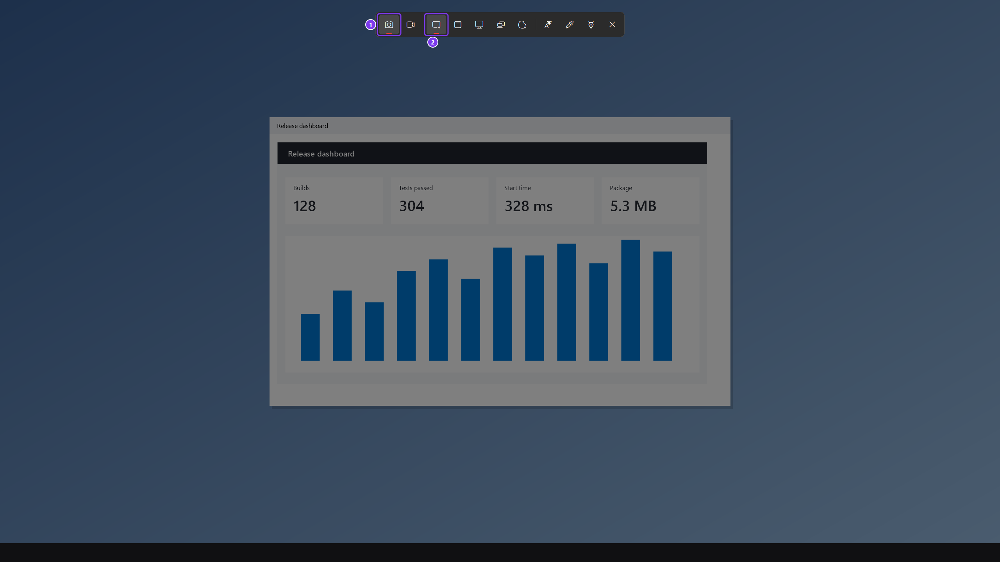
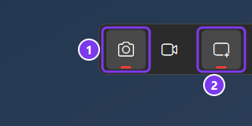

The screen freezes and a small bar appears at the top. Check that **Photo** (1) and **Rectangle** (2) are selected.

## 2. Select the area

Drag with the mouse over the part of the screen you want. Let go of the mouse button at the opposite corner.

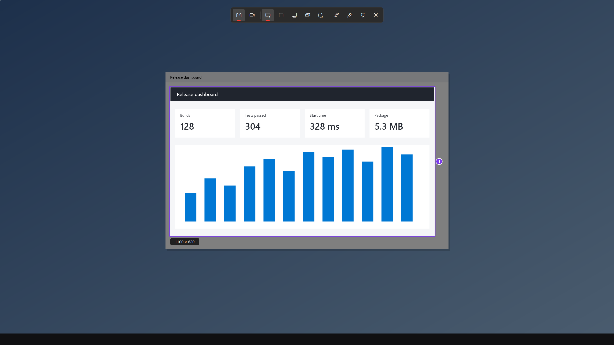

When you let go, the Clipmark editor opens with your screenshot.

## 3. Choose the rectangle tool

Click **Shapes** in the toolbar at the top. The button shows a square.

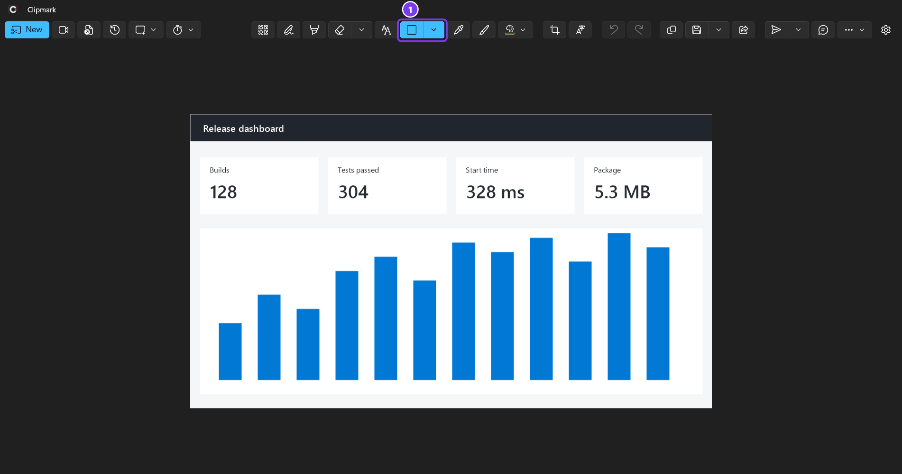
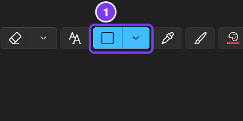

The button turns blue. Your mouse now draws rectangles.

## 4. Draw a frame

Drag over the part of the screenshot you want to point out.

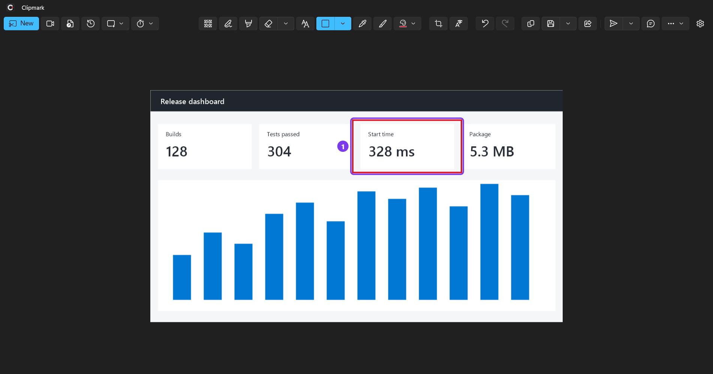

A red frame appears where you dragged.

## 5. Choose the arrow

Click the small arrow next to **Shapes**, then click **Arrow**.

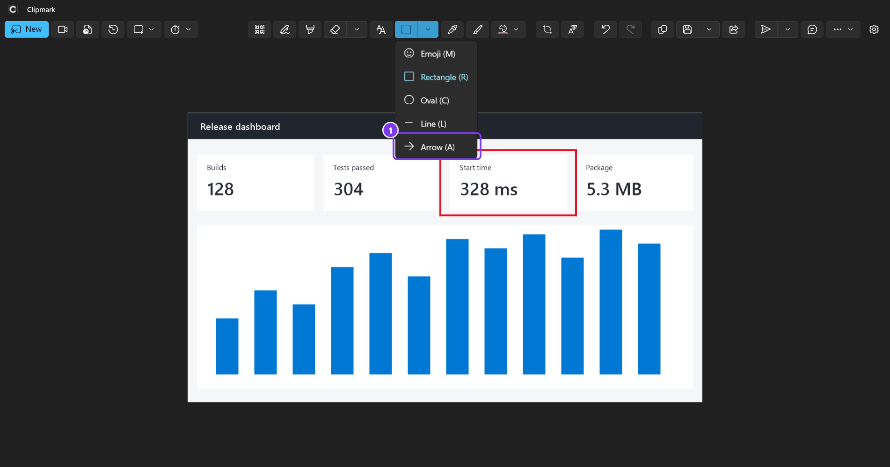
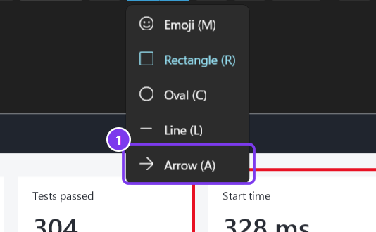

The **Shapes** button now shows an arrow. You can also press `A` to choose the arrow.

## 6. Draw an arrow

Drag from where the arrow should start to where it should point.

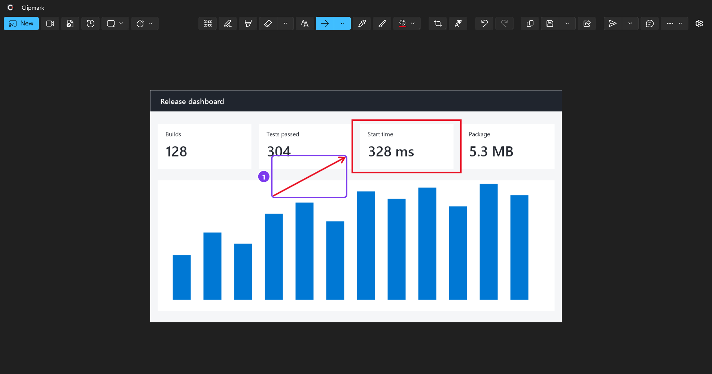

The arrow appears with its tip where you let go.

## 7. Copy or save the screenshot

Click **Copy** (1) to paste the screenshot into a mail or chat with `Ctrl`+`V`. Or click **Save as** (2) to keep it as a file.

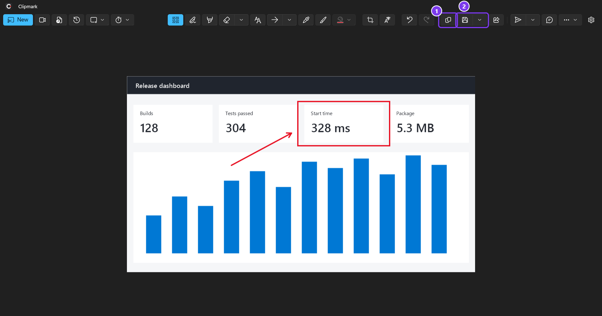
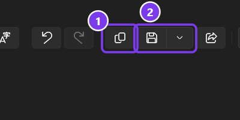

With **Save as**, a window opens. Choose a folder and a file name, then click **Save**.

## Something went wrong?

### Nothing happens when you press the keys

Another app may use the same keys. Clipmark then shows "Ctrl+PrintScreen is used by another app. Choose a different hotkey in Settings." Open **Settings** in Clipmark and choose a different **Capture hotkey**.

### You want to use only the Print Screen key

Open **Settings** and click **Open Windows keyboard settings**. Turn off the Windows option that opens screen capture with Print Screen. Then choose PrintScreen as the **Capture hotkey**.

### The screenshot was not copied

You see "The clipboard is in use by another app; the capture was not copied." Wait a moment, then click **Copy** again.

### You drew in the wrong place

Press `Ctrl`+`Z` to undo the last change.
